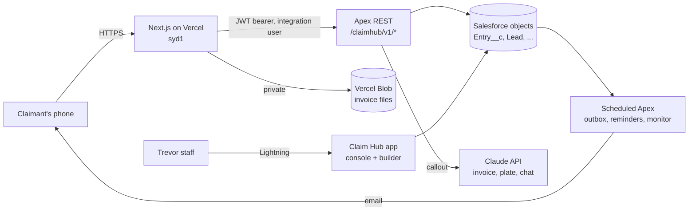
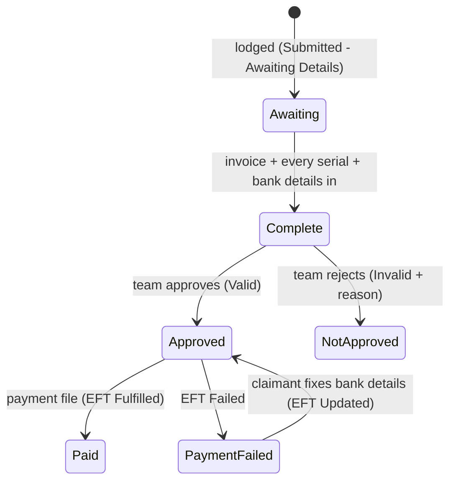

# Architecture

## Shape

**Salesforce is the system of record and holds the logic.**
- Every rule, such as eligibility, tiers, serial checks or bank formats, is in Apex, so the old forms, reports and the C4C feed see the same data.
- The web app is a thin, stateless front end. It renders pages, shrinks photos on the phone, stores invoice files and forwards requests.
- The web app holds no claim data, and no browser ever talks to Salesforce.

**Why a separate web app, not Experience Cloud.**
- Pages load fast on mobile.
- No guest-user access to the org: the old forms' guest-user exposure was the root of the claim-link security fix.
- No per-login licence cost.
- Releases are independent of the org.

The cost is one integration user and one more deployment. See [decisions.md](decisions.md).

## Request path

1. The browser calls a route under `web/app/api/*`. Each route:
   - checks the shape of the request (slug or link-code format, and body size: 64 KB, or 3 MB for photos);
   - adds the caller's IP address as `X-Hub-Client-IP`;
   - calls `hub()` in `web/lib/sf.js`.
2. `hub()` signs a JWT with the integration user's private key and exchanges it for an access token.
   - The token is cached for 50 minutes. A 401 triggers a fresh sign-in and one retry.
   - Calls time out at 55 seconds.
   - GETs retry once on a network error. POSTs never retry.
   - If Salesforce is unreachable, the caller gets a plain 503.
3. `ClaimHubApi` (Apex REST) routes the call to the right class.
   - Calls that make no callout run inside a savepoint, so any refusal rolls back completely.
   - Refusals that still need the team's attention, such as a duplicate or second-quality serial, are recorded after the rollback.
   - Unexpected errors go to Nebula Logger. The caller gets only a reference id.

## Campaign designs

Each campaign has its own look (decisions.md #10). A design is a folder named after the campaign slug:

| File | What it is |
|---|---|
| `page.html` | The entry page, from the studio. `<hub-slot name="...">` marks where the hub's own blocks go: `claim-form`, `resend`, `how-it-works`, `tiers`, `key-dates`, `terms`. If the page has no `claim-form` slot, the form is added at the end. |
| `style.css` | The page's styles. |
| `theme.json` | Colours, font, logo, favicon. Also used on the private claim page (`/c`), which finds the campaign from the claim link. |
| images, fonts | Referenced by file name only, served from `/designs/<slug>/<file>`. |

`{{placeholders}}` in the page are filled from the campaign record (`name`, `headline`, `brandName`, `retailers`, `supportEmail`, `purchaseFrom`, `purchaseTo`, `claimsClose`, `minSpend`, `maxCashback`). Dates and amounts on the page therefore always match the rules the engine applies. Dates should not be baked into banner images.

Designs are treated as untrusted (`web/lib/designs.js`):
- scripts, event handlers, frames, forms and inline `<style>` are removed;
- images, fonts and `url()` may only point at the design's own files;
- links may only be `https:`, `mailto:`, `tel:` or anchors.

The same page takes bank details, so none of these can be switched off per campaign.

Where designs live:
- *Sandbox:* `web/designs/<slug>/`, shipped with the web app.
- *Production:* the public asset store, uploaded by staff from the console (roadmap, Phase 2).

The loader is the only code that changes when designs move to the asset store.

## Salesforce classes

| Class | Job |
|---|---|
| `ClaimHubApi` | REST router, savepoints, error mapping. |
| `ClaimHubService` | Campaigns, lodging, the claim view, serials, invoice upload, bank changes, link resend. Also the status engine (`recompute`). |
| `ClaimHubBank` | Bank detail checks: NZ check digits, and bank, branch and BSB lookups in the registers (decisions.md #11). |
| `ClaimHubInvoice` | Checks an invoice, as read by Claude, against the claim and the rules. Lists problems; never refuses on its own. |
| `ClaimHubAssistant` | The help chat. Answers from the terms summary and the claim, and hands over to a person. |
| `ClaimHubVision` | All Claude calls in one place. Fails soft: an outage sends work to the team instead of failing the claimant. |
| `ClaimHubNotifier` | Email outbox (`Claim_Notification__c`), templates, debounced progress summaries. |
| `ClaimHubDispatchJob` | Queueable that sends due emails. It is kicked by every new email and re-schedules itself for delayed ones. |
| `ClaimHubEntryHandler` | When the team changes a claim (approve, reject, pay, payment failed), emails the claimant. Bulk-safe. |
| `ClaimHubReminders` | Daily: up to four reminders for claims with missing items. Counts from the outbox, so it never updates the claim. |
| `ClaimHubMonitor` | Hourly: sends anything stuck, checks health, emails an alert. Also backs `GET /health`. |
| `ClaimHubFiles` | Short-lived staff tickets for invoice files kept outside Salesforce. |
| `ClaimHubTerms` | Terms to campaign: Claude extraction, builder checks, date carry-over, campaign creation. |
| `ClaimHubConsole` | Staff console data and actions. Runs in user mode. |
| `ClaimHubSettings` | Operating settings with safe defaults (`Claim_Hub_Settings__c`). |
| `ClaimHubLog` | The claim audit trail (`Claim_Event__c`) and Nebula Logger wrapper. |
| `ClaimAccessToken` | 256-bit random claim link codes. |

## Data model

The hub adds no parallel claim objects. It writes the existing ones, so reports, the payments batching file and the C4C flow keep working.

| Object | Hub use |
|---|---|
| `Promotional_Campaign__c` | One per promotion, created by the builder. Hub settings live in `Hub_*` fields: slug, country, deadlines, retailers, minimum spend, excluded serial prefixes, cap, terms summary, the builder's spec and issues. |
| `Cashback_Range__c` | Tiers. A fixed amount (`Cashback_Value__c`) or a percentage (`Percentage__c`), by quantity and/or spend band. |
| `Promotional_Product__c` / `Campaign_Product__c` | The participating models. |
| `Lead` | The claimant: name, contact and bank details. Emails go to the Lead, so they don't use the single-email allowance. |
| `Entry__c` | The claim. Shared record type `Claim_Hub`. Carries the same stamps as the old forms: campaign stamp, created-at fields, consumer stamps, bank stamps and terms accepted. Also `Hub_Dedupe_Key__c` (unique per campaign and email) and `Hub_Client_IP_Hash__c`. |
| `Entry_Product__c` | One per appliance: price, serial and PNC. `Hub_Serial_Key__c` is unique, so a serial cannot be saved twice. |
| `Entry_Receipt__c` | The invoice: OCR results, check status, `Hub_File_Key__c` (the private Blob path), `Hub_Invoice_Key__c` (retailer and invoice number, indexed) and the staff ticket hash and expiry. |
| `Claim_Event__c` *(new)* | Audit trail. Actions starting `Needs review:` feed the console queue. Those, and `Internal:` actions, are never shown to the claimant. |
| `Claim_Notification__c` *(new)* | The outbox. Every email exists as a record first: Queued, then Sent, Failed, Skipped or Merged. |
| `Claim_OTP__c` *(new)* | Bank-change codes. Only the hash is stored. They expire after 10 minutes, allow 5 attempts each, and at most 10 can be issued a day. |
| `Hub_Bank_Branch__c` *(new)* | Bank registers: Payments NZ branches and AusPayNet BSBs, keyed `NZ-01-0242` / `AU-062-000`. Public reference data, loaded monthly by `scripts/load-bank-register.mjs`. |
| `Claim_Hub_Settings__c` *(new)* | Hierarchy custom setting: limits, debounce time, alert email, model and file link base. |

## Claim lifecycle

The claimant sees one of six stages, mapped in `ClaimHubService.stage`: awaiting, review, approved, paid, payment_failed and not_approved.

**Emails.**
- On lodge.
- A debounced progress summary: changes within 10 minutes go in one email.
- On completion.
- On approve, reject, pay or payment failure.
- On a bank change, so the account holder is alerted if it wasn't them.
- Up to four reminders.
- The link resend.

## Background jobs

| Job | When | What |
|---|---|---|
| `ClaimHubDispatchJob` | On demand | Sends due emails. Chains itself for emails queued for later. |
| `ClaimHubReminders` | Daily, 9am | Reminders at 7 and 21 days, then 14 and 3 days before the serial deadline. |
| `ClaimHubMonitor` | Hourly, at :05 | Sweeps the outbox and emails an alert on stuck or failed emails, or when invoices stop being read. |

Schedule them with `scripts/apex/schedule-jobs.apex`.

## Electrolux C4C

The `Electrolux_C4C_Integration` flow sends an Entry to C4C when it is saved by a user who holds the `ElectroluxC4C_Basic_Auth_Access` permission set.
- The hub integration user does not hold it. Claimant activity therefore does not send messages to C4C.
- Staff decisions in the console do send them, as they do today.
- Reminders deliberately never update the Entry, so they cause no C4C sends.

Whether hub claims should reach C4C on lodge is an open decision. See production-checklist.md.
